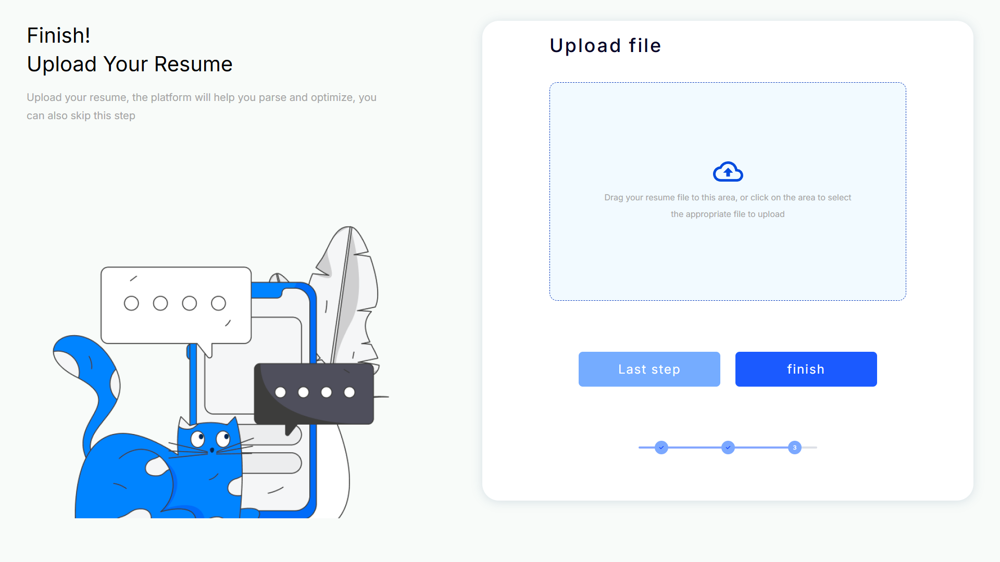
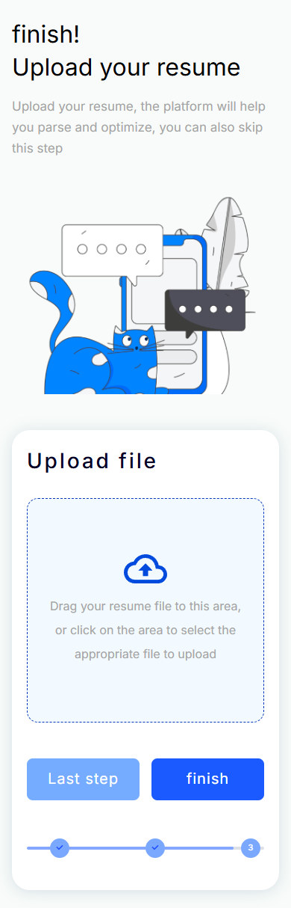

# 前端笔试：Figma 设计稿还原 —— 上传简历页面

## 题目介绍

根据 Figma 设计稿，高精度还原「上传简历」页面中的局部界面：左侧标题与插画，右侧上传文件卡片（虚线上传区、操作按钮、步骤进度指示器）。原始 Frame 为 1920×1080，实现时按内容区裁剪，不还原整画布留白，也不按原始比例整体缩放。

## 笔试要求

基础要求：

- 页面结构及布局正确
- 字体、颜色、按钮样式、图标位置、边框、阴影、圆角等视觉元素准确还原
- 特别注意上传区域的虚线边框、背景、图标对齐
- HTML 结构清晰，符合语义化要求

加分要求：

- 点击上传区域打开系统文件选择框
- 按钮具备 hover 和 active 状态
- 页面无明显功能性错误
- 窄屏 / 移动端自动由左右布局调整为上下布局
- 上传文件后显示文件名

## 技术栈

- React 18 + TypeScript（Vite 构建）
- 原生 CSS（Flexbox 布局、CSS 自定义属性管理设计 token）
- @fontsource/inter（本地打包 Inter 字体，与 Figma 设计一致）
- Puppeteer Core + 系统 Edge（浏览器自动化验收）

## 实现功能

- **Figma 设计还原**：所有颜色、字号、行高、字距、圆角、阴影均取自提取的设计 token（见 `figma-data/processed/design-tokens.json`），间距按节点坐标换算
- **文件选择**：点击上传区或按 Enter/Space 打开系统文件选择框
- **拖拽上传**：支持拖拽文件到上传区
- **文件名展示**：选择或拖入文件后，在上传区显示文件名与大小
- **按钮交互状态**：hover 加深、active 加深并下移，focus-visible 焦点环
- **响应式布局**：≤1024px 自动由左右布局切换为上下布局，经 1920 / 1440 / 768 / 390 四种视口实测
- **无障碍**：语义化标签、`role="button"` 上传区、键盘可操作、屏幕阅读器标注、图片替代文本

## 目录说明

```text
Front-end/
├── app/                  # 前端页面源码及自动化测试
│   ├── src/              # React 组件与样式
│   ├── public/assets/    # 页面使用的 SVG / PNG 素材（来自 Figma 导出）
│   └── test/             # e2e 验收脚本、截图与报告
├── figma-data/           # 设计数据、提取脚本及素材
│   ├── raw/              # Figma REST API 原始响应
│   ├── processed/        # 结构化设计树、设计 token、素材映射
│   ├── assets/           # 全部导出素材（svg/ 与 images/）
│   └── scripts/          # 数据提取脚本（可重跑，素材自动复用）
└── docs/screenshots/     # README 预览截图
```

## 运行与测试

```bash
cd Front-end/app
npm install        # 首次运行
npm run dev        # 开发服务器，http://localhost:5173
npm run build      # 生产构建（含 tsc 类型检查），输出 dist/
npm run test:e2e   # 自动化验收：自动起 dev server + Edge 无头浏览器，
                   # 输出 report.json 与多尺寸截图到 test/
```

## 页面预览

桌面端（1920×1080）：



移动端（390×844，自动切换为上下布局）：



## 实现说明

开发流程：**Figma REST API → 设计数据提取 → 素材本地化 → 前端页面实现 → 浏览器自动化测试**。

1. 目标文件为仅 `can view` 权限的共享设计稿，官方 Figma MCP 因要求编辑权限无法读取，改用 Figma REST API（Personal Access Token，需 `file_content:read` scope）成功读取，原始响应保存于 `figma-data/raw/`。
2. 提取脚本（`figma-data/scripts/`）将原始 JSON 解析为前端友好的 `design-tree.json`（节点树 + 相对坐标 + 完整样式），并汇总 `design-tokens.json`；素材通过官方 images 导出接口批量下载到本地。
3. 页面实现完全基于上述结构化数据，素材使用本地化 SVG/PNG，未使用整页截图替代结构。
4. 使用浏览器自动化对四种视口和全部交互（文件选择、文件名展示、hover/active、键盘操作、响应式）做了实测验收。

说明：Figma REST API 与 Token 仅用于开发阶段提取设计数据；最终页面独立运行，不依赖 Figma 任何服务。开发过程中使用了 AI 编程工具辅助数据提取与代码实现。
